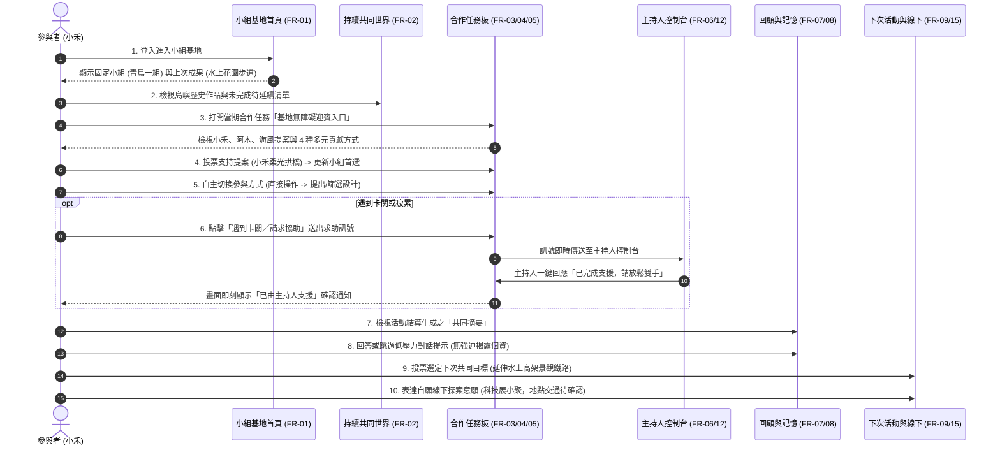
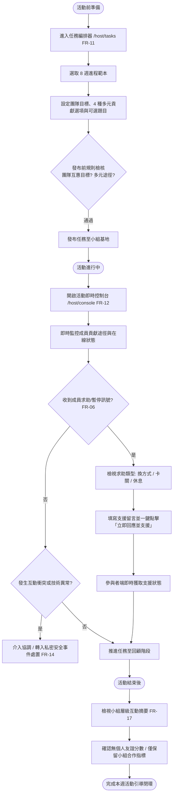
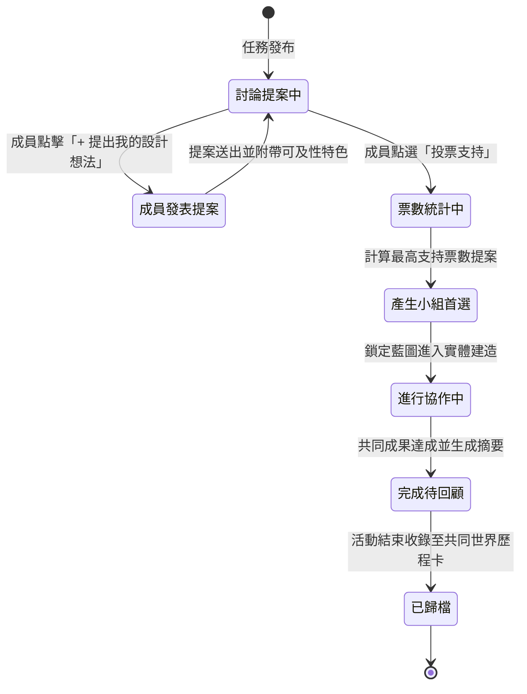
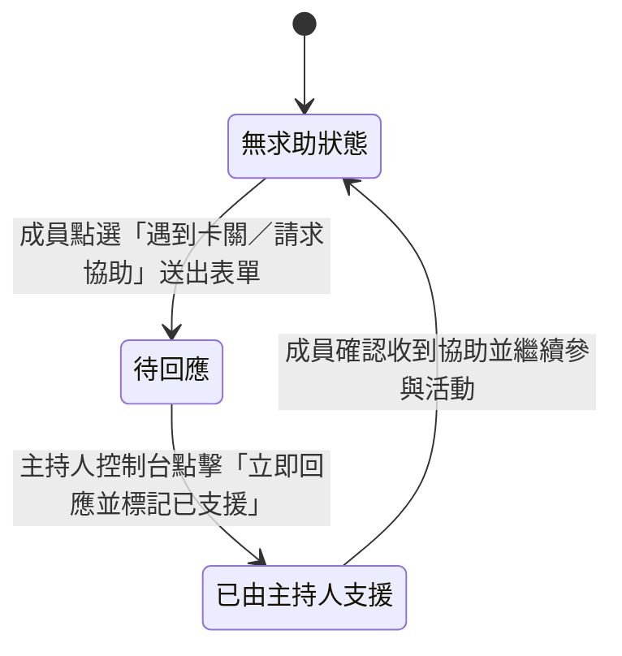
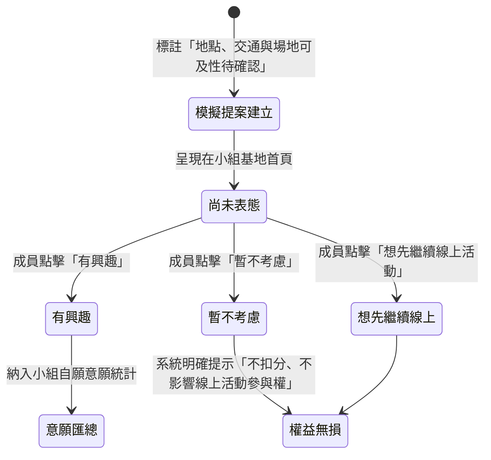
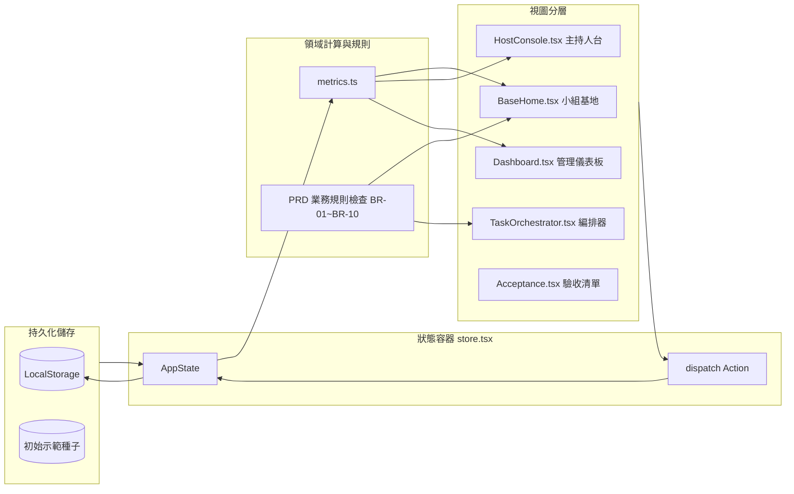

# 攜手基地 PRD v2.0 系統架構圖與使用者流程圖

本文件提供「攜手基地 — 以線上遊戲為媒介的友誼支持系統 (PRD v2.0)」之完整系統架構、使用者流程圖與狀態機流轉圖。

---

## 1. 系統整體架構圖 (System Architecture)

系統定位為「友誼發展支持層」，不取代外部沙盒遊戲（如 Minecraft Creative），專注於維持關係連續性、互惠任務決策、低壓力社交與安全管理。

```mermaid
graph TD
  subgraph Client_Presentation [前端展示層 (React 19 SPA + Vite + Vanilla CSS Tokens)]
    subgraph Role_Participant [參與者視角 (小禾)]
      P_Base[小組基地首頁 FR-01 /]
      P_World[共同世界成果卡 FR-02]
      P_Task[合作任務板 FR-03]
      P_Prop[提案與投票 FR-04]
      P_Mode[貢獻方式切換 FR-05]
      P_Help[求助與暫停 FR-06]
      P_Memory[共同記憶與成果 FR-08]
      P_Retro[低壓力回顧 FR-07]
      P_Next[下次計畫投票 FR-09]
      P_Off[自願線下探索 FR-15]
    end

    subgraph Role_Host [引導主持人視角 (陳主持)]
      H_Console[活動即時控制台 FR-12 /host/console]
      H_Orch[任務範本編排器 FR-11 /host/tasks]
      H_HelpDesk[求助即時處置工作台]
      H_Metrics[小組互動摘要觀察 FR-17]
    end

    subgraph Role_Admin [服務管理支援層]
      A_Dash[成效儀表板 FR-17 /admin/dashboard]
      A_Group[固定小組管理 FR-13 /admin/groups]
      A_Session[場次排程 FR-13 /admin/sessions]
      A_Issue[私密安全事件處置 FR-14 /admin/issues]
      A_Acc[需求驗收矩陣 /acceptance]
    end

    ScenarioBar[PRD 第 9 節 9 步情境導覽浮條 (ScenarioStepper)]
  end

  subgraph State_Domain [狀態與領域邏輯層 (React Context + Reducer)]
    Store[AppStore 狀態中樞]
    Reducer[appReducer 狀態轉移機]
    MetricsCalc[metrics.ts 指標運算引擎 (無個人排名)]
  end

  subgraph Persistence_Data [資料與模擬層]
    LocalStorage[(瀏覽器 LocalStorage: hand_in_hand_state_v2)]
    SeedData[PRD v2.0 虛構示範資料庫 seed.ts]
    SimBadgeRule[PRD 誠實標籤約束層 (示範資料 / 待確認 / 模擬狀態)]
  end

  Client_Presentation <--> State_Domain
  State_Domain <--> Persistence_Data
```

---

## 2. 參與者核心旅程使用者流程圖 (Participant Core Journey)

嚴格對應 PRD 第 5.1 節與第 9 節端到端情境：



---

## 3. 主持人引導與即時協調流程圖 (Host Facilitator Flow)

對應 PRD 第 5.2 節與 FR-11、FR-12：



---

## 4. 關鍵領域狀態機流轉圖 (State Machines)

### 4.1 提案與共同決策狀態機 (FR-04)


### 4.2 求助與暫停處置狀態機 (FR-06, FR-12)


### 4.3 線下與活動外探索意願狀態機 (FR-15)


---

## 5. 資料流與模組相依架構 (Data Flow Architecture)


