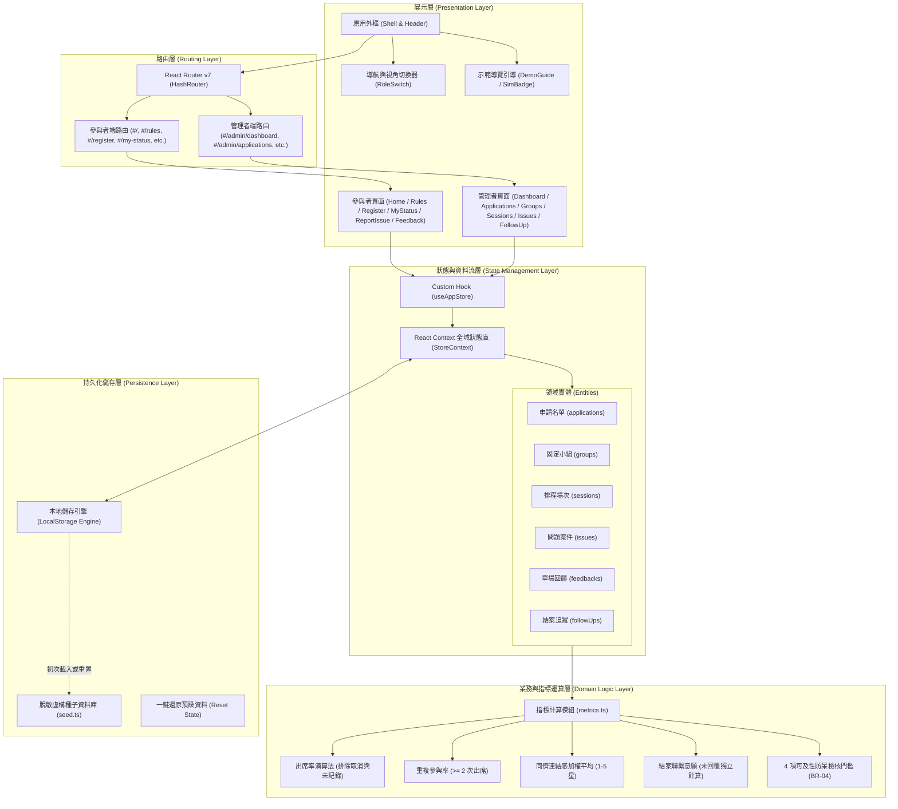
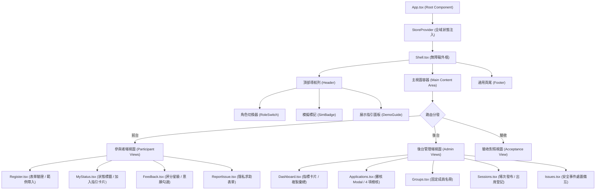
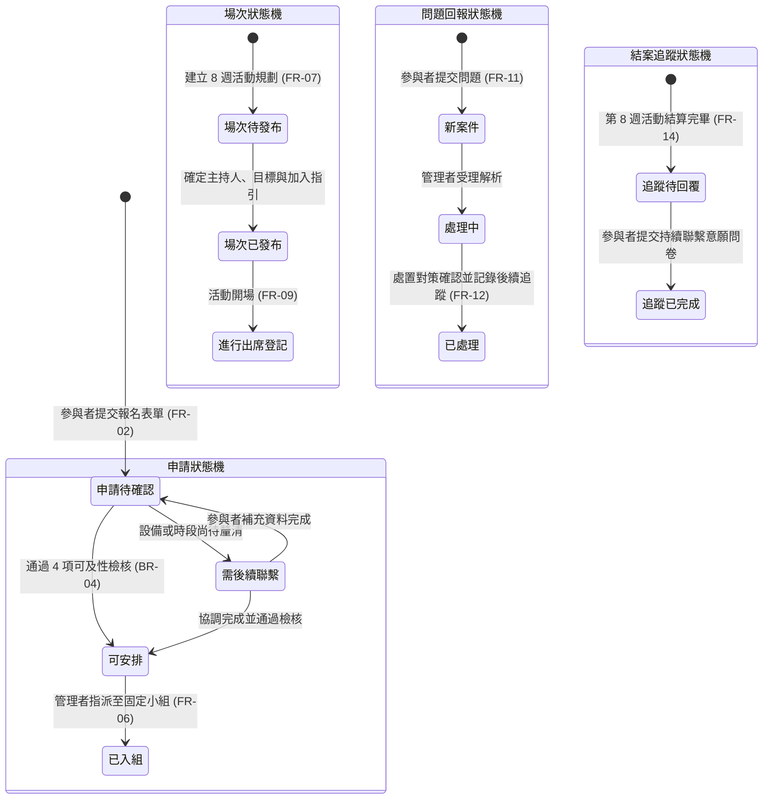
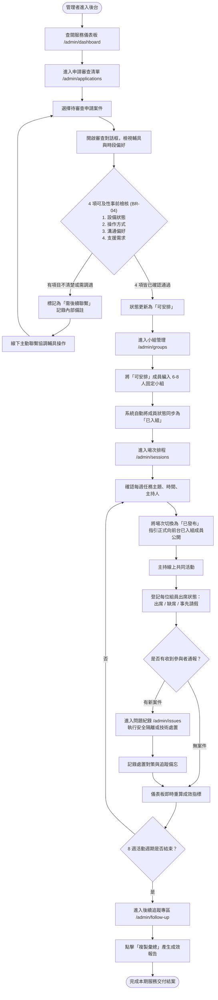
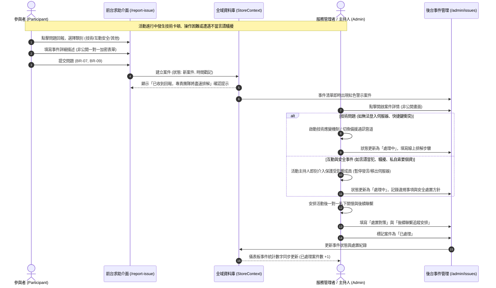

# 攜手基地 (Hand-in-Hand) — 系統架構圖與使用者流程圖

本文件提供「攜手基地 (Hand-in-Hand)」系統之完整技術架構、組件層級、狀態機模型與三條核心業務流程圖，採用標準 Mermaid 語法繪製，便於技術審查、交付驗收與後續擴充。

---

## 1. 系統架構圖 (System Architecture)

### 1.1 全端分層架構 (Layered Architecture)

系統採用輕量化、高效能的前端單頁應用（SPA）架構，嚴格遵循責任分離原則（Separation of Concerns）：



---

### 1.2 前端組件層級樹 (Component Hierarchy)



---

### 1.3 核心實體狀態機 (State Machine Model)

系統包含四個嚴格遵循 PRD 規格的狀態轉換生命週期：



---

## 2. 使用者流程圖 (User Flows)

### 2.1 參與者端到端主流程 (Participant End-to-End Journey)

涵蓋從了解服務、報名檢核、狀態查詢、加入活動、問題求助到完成回饋之完整旅程：

```mermaid
flowchart TD
    Start([參與者抵達首頁]) --> ViewService[瀏覽服務定位與固定小組介紹]
    ViewService --> ReadRules[閱讀安全守則與常見問答 /rules]
    ReadRules --> CheckEligible{是否符合條件？<br/>年滿18歲 & 移動受限成人}
    
    CheckEligible -- 否 --> ExitNotEligible([感謝關注，不符合本案試辦條件])
    CheckEligible -- 是 --> GoRegister[進入報名頁面 /register]
    
    GoRegister --> FillForm[填寫表單：聯絡資訊、可用時段、<br/>操作方式、溝通偏好]
    FillForm --> FormCheck{表單驗證<br/>BR-01 年齡檢核<br/>BR-02 同意守則}
    
    FormCheck -- 未通過 --> ShowFormErrors[顯示無障礙錯誤提示摘要]
    ShowFormErrors --> FillForm
    FormCheck -- 通過 --> SubmitApp[送出申請 (立案: 待確認)]
    
    SubmitApp --> ViewMyStatus[進入「我的狀態頁」/my-status]
    ViewMyStatus --> StatusPolling{當前申請狀態}
    
    StatusPolling -- 待確認 / 需後續聯繫 --> WaitStaff[顯示狀態文字解讀，等待團隊審查協調]
    StatusPolling -- 可安排 --> WaitGroup[已通過可及性確認，等待小組分派]
    StatusPolling -- 已入組 --> EnrolledView[看見所屬小組名稱與組員暱稱]
    
    EnrolledView --> CheckSessionInfo[查閱每週場次排程與共同任務目標]
    CheckSessionInfo --> SessionStatusCheck{場次是否已發布？}
    
    SessionStatusCheck -- 待發布 --> WaitPublish[顯示「待發布」狀態，暫不公開連線網址]
    SessionStatusCheck -- 已發布 --> ViewJoinGuide[查閱 Minecraft 伺服器 IP、<br/>語音文字頻道與備援聯絡人]
    
    ViewJoinGuide --> JoinActivity[進入遊戲與固定同儕協作互動]
    
    JoinActivity --> TroubleHappened{活動中是否遭遇<br/>技術或互動安全問題？}
    TroubleHappened -- 是 --> GoReport[前往問題求助頁 /report-issue<br/>一對一私密通報]
    TroubleHappened -- 否 --> CompleteSession[完成當次共同任務]
    
    GoReport --> SubmitIssue[提交事件，管理者端即時受理排解]
    SubmitIssue --> CompleteSession
    
    CompleteSession --> SubmitFeedback[前往回饋頁 /feedback<br/>評定同儕連結感與活動評分]
    
    SubmitFeedback --> WeekCycle{是否已完成 8 週週期？}
    WeekCycle -- 否 --> EnrolledView
    WeekCycle -- 是 --> FillFollowUp[填寫結案後續追蹤問卷<br/>自評同儕繼續聯繫意願]
    FillFollowUp --> EndJourney([圓滿完成同儕服務旅程])
```

---

### 2.2 管理者作業與活動維運流程 (Admin Operations Flow)

管理者在整個服務週期中的日常作業流程，包含審查、排程、維運與結案統計：



---

### 2.3 活動中異常與安全處置流程 (Issue Reporting & Safety Escalation Flow)

嚴格隔離個資、保障受害者安全與維持小組平穩運作之處置機制：



---
*文件編制：Hand-in-Hand 產品研發團隊*
