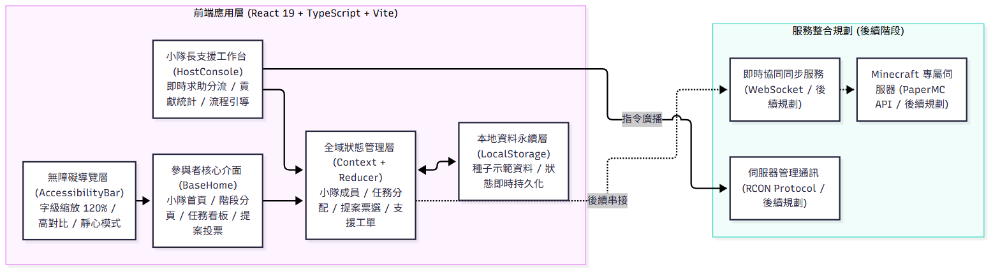
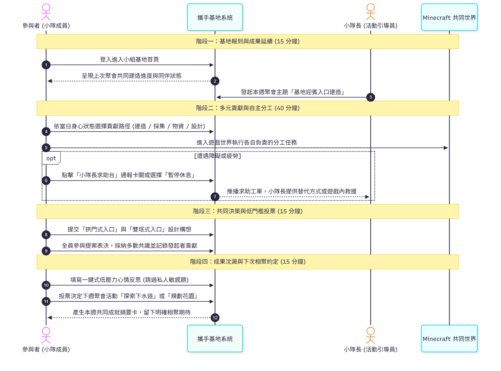
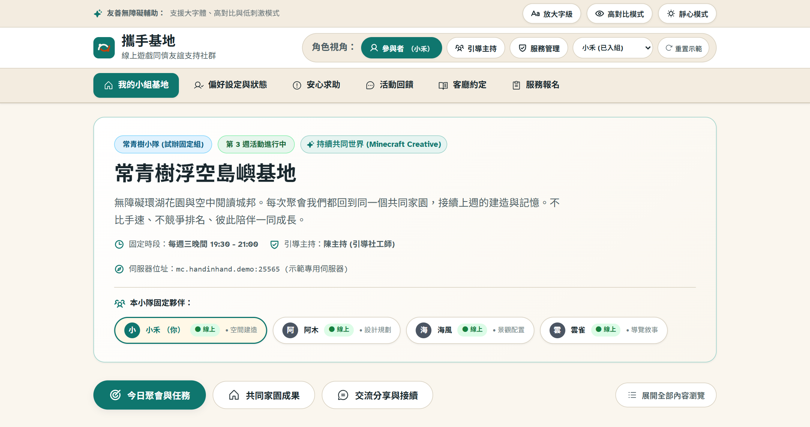
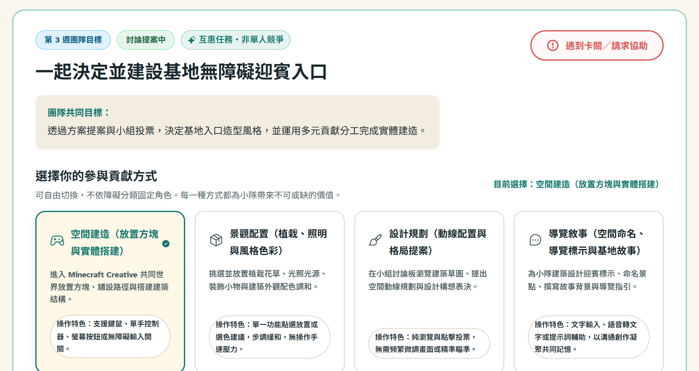
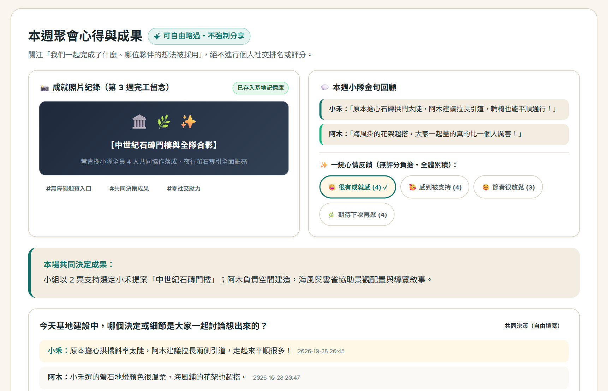
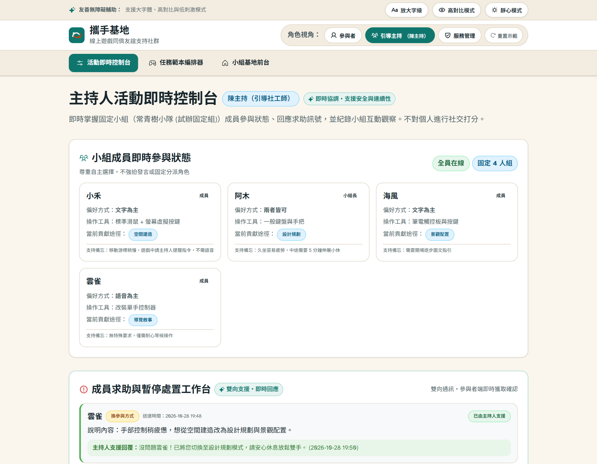

# 攜手基地：以線上遊戲孕育友誼與社會連結

**115 年「資訊人社會關懷獎學金」提案書**  
提案人：梁祐齊（國立中央大學／資訊管理學系／碩士一年級）　共同提案人：＿＿＿＿＿＿（如有）  
中華民國 115 年 10 月

## 提案摘要
全臺領有身心障礙證明者超過 123 萬人。衛福部調查顯示，近兩成肢體障礙者從事休閒面臨困難，無障礙設施缺乏率為全體平均 1.5 倍，社團參與率僅 21.36%。在現實環境中，外部交通、無障礙動線與體能負荷的高昂門檻，使行動障礙者離開學校後社交網絡嚴重萎縮；在障礙者心裡，則長期承受孤獨感與社交焦慮，難以建立穩定歸屬感。為尋求同儕互動，許多人轉向線上遊戲；然而市面熱門遊戲多強調手部快速反應與陌生玩家競技體驗，機能受限者容易跟不上節奏而反覆受挫，且短暫而隨機的遊戲配對更難以累積長期互信。

為突破困境，本專案提出「攜手基地」友誼支持系統，以開放無壓力的沙盒遊戲為媒介，建立 6–8 人的固定同儕小組。以「合作共創代替競爭對抗」，並依個人能力彈性分工，讓不同機能成員都能自在貢獻、平等交流，將線上玩樂體驗轉化為真誠互助的深厚友誼。

專案已完成可操作原型開發，規劃於桃園推動 16 週先導試辦，導入世界衛生組織社會連結指標檢驗成效，建立真正意義上的無障礙數位友誼機制。

## 一、關懷議題與研究依據

### （一）問題背景與現實困境：行動障礙者的休閒缺失與社交瓶頸
穩定的同儕關係是維持心理健康之基石。然而行動障礙成人參與實體社交面臨高昂門檻，外出活動不僅耗費體能，更受限於無障礙交通班次、建築動線與照護人力調配，使障礙者離開校園或機構後面臨社交網絡萎縮與休閒邊緣化。

依據《身心障礙者權利公約》（CRPD）第 19 條與第 30 條，應保障障礙者融入社區及平等參與休閒權利（全國法規資料庫，2014）。然而實踐現況仍具落差。臺灣領有身心障礙證明者達 123 萬 2,280 人，占人口 5.27%（行政院，2025）。衛生福利部（2023）調查顯示，身障者 17.53% 從事休閒曾遇困難，肢體障礙族群困難率達 19.46%。在環境阻礙中，「無無障礙設施」（5.36%）、「設施不良」（4.56%）及「設施不足」（3.75%）比率，均為全體平均之 1.3 至 1.5 倍；社團參與率僅 21.36%，逾八成未參與者以身心健康為首要考量。這些調查數據具體反映出，實體環境與體能限制大幅限縮了行動障礙者的社交機會。因此，行動障礙者相當需要能自主掌握步調、生理負擔較低的遠距活動管道，藉此滿足其建立同儕連結的日常需求。

### （二）解決方案：讓線上遊戲孕育友誼
為克服地理與空間障礙，遠距資訊科技常被視為具潛力之替代管道。然而現有商業多人線上遊戲難以直接轉化為有意義之同儕支持。主流商業遊戲多以精細微操、即時反應與隨機匿名對抗為導向；此類機制對動作機能受限或易疲勞者門檻過高，常在遊戲中承受挫折甚至群體排擠。更關鍵的是，商業遊戲中短暫、片段式且匿名的隨機配對，無法孕育出長期互信與實質友誼。

為突破上述瓶頸，本專案提出之「攜手基地」立足於社會心理學與無障礙人機互動實證，確立其三大核心價值支柱：

首先，針對「線上互動能否轉化為現實同儕支持」的普遍質疑，Trepte et al. (2012) 發表於期刊《Computers in Human Behavior》調查 811 位玩家證實：線上互動累積之「熟悉度」與「社會鄰近感」，能顯著預測橋接型與連結型社會資本生成，進而轉化為線下實質之情感與工具性社會支持；當互動由遊戲內擴展至遊戲外時，更能鞏固深層信任網絡。該研究為「以線上遊戲作為友誼孕育載體」奠定了穩固的理論基礎。

然而，以線上遊戲為媒介存在兩大關鍵挑戰：如何避免過度沉迷，以及如何化解操作能力落差造成的群體失衡？就時間管理而言，遊戲並非越久越好；Scheifer & Samuel (2025) 系統性回顧 22 篇多人遊戲文獻證實，共玩能累積社會資本，但時間過長反會引發疲勞與摩擦等負面後果。因此，本專案確立每週一次、每次 75–90 分鐘的固定聚會時程，守護參與品質。在能力平衡方面，Baltzar et al. (2023) 提出之多人遊戲社交可及性架構指出，群體若僅依賴單一操作表現，易引發強者主導、弱者邊緣化；唯有多模態溝通、共同操作、隨時暫停與自主步調方能實現包容。本專案據此建構空間建造、景觀配置、設計規劃、導覽敘事四項平等分工路徑，將操作壓力解構為多元角色，確保不同機能者皆享有實質貢獻機會與尊嚴。

### （三）實證可行性與核心問題
在機制設計之外，遠距同儕模式在身障成人族群中的可行性已獲國際實證支持。Best et al. (2024) 針對身體障礙成人進行 8 週線上團體介入，取得 78% 參與接受率與 22% 低流失率，證實線上同儕小組模式具備落地可行性；研究指出「事前一對一數位導入」與「數據連線補貼」是消除參與門檻、維持長期出席之關鍵。此外，Lai et al. (2023) 針對身障青少年的虛擬協作試辦亦證實，88% 參與者成功結交新友、50% 課外自發相約同玩，充分驗證線上合作能促進友誼向日常生活自然延伸。

然而，線上遊戲雖具累積社會資本之潛力，多數商業遊戲為競技導向的團隊合作，缺乏專為身心障礙同儕設計的包容機制與關係支持，致使活動往往止步於短暫娛樂，難以交織為持久互助的友誼。

立足於此一研究與實踐缺口，本專案欲探討之問題在於：**如何透過線上遊戲，協助行動障礙者建立線上友誼與線下連結？** 

本專案聚焦於資訊系統對同儕關係發展的促成機制，以 Minecraft 創造模式為共同創作空間，外部建構專屬友誼支持系統，透過四項多元貢獻路徑消除操作門檻、非同步提案保障平等決策，並以每週固定聚會流程累積共同記憶；規劃透過 16 週先導試辦與世界衛生組織（WHO）社會連結架構，檢驗資訊科技協助行動障礙者建立長期同儕支持之實踐路徑。

## 二、解決方案：「攜手基地」友誼支持系統

### 核心理念

「攜手基地」以 Minecraft 創造模式作為共同活動環境，並在外部建構輔助友誼發展的網頁系統。遊戲提供自由創作空間；外部系統則負責維繫固定成員、保存每次聚會進度、提供非同步公共決策、協助成員依狀態調整分工，並在聚會結束時凝聚下次相聚的期待。

### 五項核心機制與實證依據

| 系統核心機制 | 具體設計與實踐方式 | 文獻理論與實證依據 |
|---|---|---|
| **1. 固定小組與持續世界** | 6–8 人固定組隊，跨 8 週回到同一世界，首頁展現上次成果與今日進度。 | Trepte et al. (2012)：反覆相遇累積熟悉度，促成實質支持；Scheifer & Samuel (2025)：集體遊玩累積社會資本。 |
| **2. 互惠合作與多元分工** | 圍繞創造模式設計建造、景觀、規劃、敘事四路徑，支援切換與求助。 | Baltzar et al. (2023)：社交可及性原則（共同操作、自主步調、多模態溝通），確保全員皆具貢獻途徑。 |
| **3. 低壓力與固定活動時程** | 每週一次、每次 75–90 分鐘固定聚會；題目可跳過，不問病歷，支援暫停。 | Scheifer & Samuel (2025)：固定時長避免沉迷負效應；Best et al. (2024)：固定週期維持出席與安全感。 |
| **4. 共同記憶與延續決策** | 系統記錄作品照片、採納提案與金句，結尾票選下次目標，累積團體歷史。 | Trepte et al. (2012)：延續性活動強化社會紐帶；WHO (2025)：社會連結結構與功能維度之連續累積。 |
| **5. 自願的遊戲外延伸** | 成員自主提議課外同玩或實體見面；系統提供場地查核。不見面者權益不受影響。 | Trepte et al. (2012)：活動延伸至遊戲外促成強固支持；Lai et al. (2023)：4/8 成員於課外自主相約互動。 |

以迎賓入口為例：票選定案後，建造搭建拱門、景觀佈置植栽、規劃繪製動線、敘事撰寫故事。全員依能力參與並支援換角，落實互惠合作。

### 遊戲平台與多人連線技術可行性

本計畫選用 Minecraft 創造模式，具無限方塊、自由飛行與無生存限制特性，適合作為無障礙協作空間。伺服器採官方 Minecraft Realms 雲端託管，支援 10 人連線、白名單與自動備份，確保穩定安全（Mojang Studios, 2026）。

### 服務流程指引

以 6–8 位成年人組成固定小組，每週一次、連續 8 週，每場 75–90 分鐘。流程歷經回到基地回顧成果 (15m) → 今日目標與自主分工 (40m) → 共同決策表決 (15m) → 成果回顧與下次相聚約定 (15m)。

| 階段與週次 | 共同活動重點 | 關係發展與同儕互動歷程 |
|---|---|---|
| **第一階段：破冰認同**（第 1–2 週） | 共同命名基地、選擇風格主題；設計公共休息區與分享休閒偏好。 | 作出第一項共同決策，啟動團體認同；累積同伴熟悉度。 |
| **第二階段：合作互惠**（第 3–4 週） | 提出迎賓入口構想與表決；接續實體建造並展開跨角色協作。 | 練習傾聽他人想法，建立相互回應體驗與多元角色貢獻感。 |
| **第三階段：共創賦權**（第 5–6 週） | 為景點命名與創作背景故事；由成員輪流提議並帶領迷你任務。 | 凝聚專屬敘事與共同幽默感；賦權成員主動性，轉化為同儕互助。 |
| **第四階段：總結延續**（第 7–8 週） | 總結 8 週共同成果相簿；票選下次線上目標或探索自願線下選項。 | 自主延伸共同計畫；為結案後的同儕關係延續奠定基礎。 |

### 資訊系統與產品價值

系統核心任務在於降低障礙者加入遊戲與人際互動門檻，將片段操作轉化為可持續累積的共同記憶與互惠關係。目前已完成前端完整互動原型，並通過核心邏輯測試。

#### 1. 系統總體架構與技術實作

系統採用單頁式網頁應用程式架構開發，強調無障礙親和力與輕量快速載入：

*圖 2-0-1 說明：前端包含無障礙導覽、基地主介面、主持工作台與全域狀態層，離線儲存於本機；後續階段以 WebSocket 串接 PaperMC 與 RCON 協定。*

- **前端技術堆疊：** 採用 React 19、TypeScript 5.7 與 Vite 6.2，確保型別安全與渲染效能。
- **狀態管理與離線永續：** 採用 React Context 與狀態分流機制統籌五大資料模型，透過本機儲存達成展示狀態復原。
- **無障礙設計規範：** 參照 W3C WCAG 2.2 原則實踐高對比配色、支援大字級切換、按鈕遵循 48×48px 觸控範圍與靜心模式。

#### 2. 端到端活動閉環流程

系統在每週聚會中提供循序漸進的互動流程，緩解社交焦慮：

*圖 2-0-2 說明：活動歷經「基地報到與成果延續 (15m)」、「多元貢獻與自主分工 (40m)」、「共同決策與低門檻投票 (15m)」、「成果累積與下次相聚約定 (15m)」四階段閉環。*

#### 3. 核心使用者介面展示與友誼支持機制

##### （1）小組基地首頁與同伴狀態感知

*圖 2-1 說明：頂部提供無障礙工具；同伴狀態條呈現隊友在線現狀，營造同在感；三頁籤降低認知負荷。*

##### （2）每週小隊目標與四大多元貢獻路徑

*圖 2-2 說明：提供四項分工路徑，成員依身心狀態自主切換，確保多元參與。*

##### （3）共同家園設計提案與低門檻表決

*圖 2-3 說明：提供非同步提案與一鍵支持，消弭口語壓力，保障平等決策權。*

##### （4）低壓力交流分享與下次相聚共識

*圖 2-4 說明：不進行個人評分，以成果與回饋累積小組歷史；下週目標票選維繫跨場次動機。*

##### （5）小隊長即時支援與卡關調適工作台

*圖 2-5 說明：主持人工作台綜覽工單，在不中斷活動節奏下提供即時調適支援。*

#### 4. 現有服務模式與攜手基地特色比較

| 比較面向 | 實體身障休閒活動 | 一般多人商業遊戲社群 | 「攜手基地」友誼支持系統 |
|---|---|---|---|
| **空間與成本** | 實體接駁出門門檻高 | 需敏捷微操與高階硬體 | 家用電腦連網即入，支援無障礙調節 |
| **關係結構** | 單次活動流動率高 | 匿名隨機配對缺信任 | 6–8 人固定組隊，跨 8 週累積熟悉度 |
| **活動連續性** | 成果難跨場次累積 | 局數獨立勝負重置無累積 | 共創同一世界，成果跨場次持續保留 |
| **分工彈性** | 受限生理機能調配難 | 偏重操作反應差距大 | 4 大路徑自主切換，全員皆具實質貢獻 |
| **支持體系** | 仰賴現場志工照護重 | 無引導者卡關缺調解 | 專屬工作台與多模態通訊，即時調適 |
| **關係延續** | 結束後聯繫受限交通 | 缺共同目標離線話題中斷 | 保存作品記憶與下次共識，自然延伸 |

#### 5. 技術驗證與原型成熟度

本專案依研發進程劃分三個具體實作層次：

| 發展層次 | 系統範疇 | 具體成果與驗證現況 |
|---|---|---|
| **已實作** | 前端架構與無障礙體驗 | • React 19+TypeScript+Vite 架構，通過型別檢查與編譯。 • Vitest 驗證出席率、重複參與率、同伴連結感等指標運算。 • 實踐高對比、48px 觸控目標、大字級與靜心模式。 • 涵蓋基地、主持工作台與展示控制台。 |
| **本機模擬** | 示範資料與情境演練 | • 成員、動態、反思與工單以展示資料於本機運行。 • 驗證介面狀態轉換與資料流正確性。 |
| **後續規劃** | 即時同步與伺服器串接 | • 規劃輕量 WebSocket 中繼伺服器跨端同步。 • 開發 PaperMC 外掛透過 RCON 自動同步進度與看板。 • 與合作單位簽署資安協議，健全隱私防護。 |

#### 6. 隱私保護與資料最小化原則

1. **不蒐集醫療診斷等敏感個資：** 僅使用暱稱、頭貼與遊戲喜好設定，不記錄參與者之身心障礙類別、等級或就醫病歷。
2. **不採用演算法社交評級：** 不設置活躍度排名等評價機制，僅中性記錄公共成果與小組提案。
3. **自主界線與漸進式延伸：** 遊戲外交流與線下見面完全基於成員自願發起；選擇不交換私人聯絡方式者參與權益不受影響。

## 三、執行與推動策略

### 招募管道與候選合作網絡

為確保目標對象招募可行性，本計畫以桃園市為初期試辦區，建立四階段推動路徑：
1. **第一階段（接洽候選網絡）：** 盤點五個具經驗重點單位，主動寄送招募意向書：
   - **中華民國身心障礙聯盟**：倡議網絡，諮詢數位參與現況並轉發推廣。
   - **財團法人脊髓損傷潛能發展中心**：傷友同儕網絡，諮詢線上休閒需求與推廣。
   - **財團法人伊甸社會福利基金會桃園服務中心**：在地社區服務，諮詢團體經驗與推廣。
   - **大專校院資源教室**：串聯大專身障學生網絡，推動青年創作小組。
   - **無障礙友善遊戲社群**：諮詢玩家操作偏好與輔具經驗並協助推廣。  
   *(註：上述單位為預計諮詢與推廣之候選網絡，活動執行採公開自主報名，恪守個資保護規範)*。
2. **第二階段（公告與自主報名）：** 公開發布招募說明會，由行動障礙成人自主報名。試辦以 8 人為目標，依 Best et al. (2024) 經驗（流失率 22%）預期 6 人穩定結案；最低規模 4 人維持運作。
3. **第三階段（數位參與導入）：** 活動前個別線上晤談，確認設備、帳號、輸入偏好（鍵鼠/控制器/改裝開關）與多模態溝通，排除初次挫折。
4. **第四階段（固定小組試辦）：** 展開 8 週固定小組共同遊戲，並於結束後進行 4 週追蹤評估。

### 16 週專案推動時程

計畫自準備至追蹤共規劃 16 週進程，將結束後 4 週關係延續追蹤完整納入執行時程：

| 階段 | 週次 | 重點工作項目 | 具體查核指標 |
|---|---|---|---|
| **階段一：原型與指引定稿** | 第 1–2 週 | • 調適任務範本與無障礙介面 • 確立安全守則、知情同意書與主持手冊 | 前端通過靜態驗證，完成手冊 |
| **階段二：接洽、招募與導入** | 第 3–4 週 | • 接洽身障網絡並轉發招募公告 • 辦理線上說明會、完成知情同意與報名 • 進行一對一設備連線測試與輔具確認 | 招募 6–8 人，全員完成連線前測 |
| **階段三：八週小組試辦** | 第 5–6 週 | • 第 1–2 場：基地命名破冰、空間主題選定 • 建立活動前社交基準數據（WHO 構面） | 首次完成命名與共同世界建置 |
| | 第 7–8 週 | • 第 3–4 場：空間建造、景觀配置與提案表決 • 進行第 4 週中期互動檢視 | 成員自主選擇合適之貢獻角色 |
| | 第 9–10 週 | • 第 5–6 場：導覽敘事、景點命名與成員提議任務 • 觀察成員自主發起之互助互動 | 出現成員自主提出並採納之方案 |
| | 第 11–12 週 | • 第 7–8 場：總成效回顧相簿、評估延續意願 • 進行第 8 週結案評估與訪談 | 完成 8 場活動，彙整作品集 |
| **階段四：成效評估與追蹤** | 第 13–16 週 | • 執行結案後 4 週關係延續自願追蹤 • 彙整質化回饋與量化數據，產出結案報告 | 完成結案報告，提出推廣建議 |

### 經費估算與計算基礎

單一小組、16 週推動期程（含 8 週試辦與 4 週追蹤）之經費概算如下。各項人力與支出均具具體工時與單價依據，總額維持 **新臺幣 76,600 元**：

| 預算項目 | 計算基礎與編列說明 | 概算（新臺幣） |
|---|---|---:|
| **專案統籌與活動準備** | 進程控管、教材編制、招募說明（60 小時 × 300 元/時，高於最低工資 196 元） | 18,000 |
| **小組主持與活動紀錄** | 8 場試辦主持及場後互動摘記（8 場 × 2.5 小時/場 × 800 元/時） | 16,000 |
| **線上技術支援與導入** | 事前設備導入、即時伺服器維護與操作調適（24 小時 × 400 元/時） | 9,600 |
| **設備、網路與輸入輔具** | 優先介接輔具中心借用，預留個別特殊輸入輔具與轉接配件租借/採購費 | 12,000 |
| **遊戲授權與雲端託管** | Realms 伺服器 3 個月加補貼無授權成員帳號（至多 4 份 × 1,000 元） | 5,000 |
| **可及性材料與教材製作** | 易讀手冊、大字操作指引卡與數位輔助說明製作（8 場 × 750 元/場） | 6,000 |
| **線下活動可行性評估** | 實體無障礙場地現勘、復康巴士動線查核、交通接駁諮詢雜支 | 5,000 |
| **參與者連線補助** | 參考 Best et al. (2024) 做法，補助連線不穩或弱勢成員流量費，維持出席率 | 5,000 |
| **合計** | **單一小組完整試辦與追蹤先導經費** | **76,600** |

*經費以獎學金及自籌款支應，並結合在地夥伴之招募網絡與輔具資源；若成員已自備帳號，授權費彈性轉作連線補貼（勞動部，2025）。*

### 風險管理矩陣

| 風險情境 | 具體因應對策 | 實證與設計依據 |
|---|---|---|
| **網路不穩或操作障礙** | 事前一對一技術導入；編列連線流量補助；支援文字、語音與靜態投票等多模態替代路徑。 | Best et al. (2024)：連線補助降低遠距參與流失率。 |
| **熟手成員主導邊緣化** | 任務依創造模式四路徑分工；採用網頁端非同步提案表決，每人一票保障實質決策權。 | Baltzar et al. (2023)：多模態與共同操作避免單一技能門檻。 |
| **成員生理疲累中途缺席** | 允許一鍵暫停並支援切換至靜態策劃；缺席不影響後續權益，保留基地進度供隨時歸隊。 | Trepte et al. (2012)：低壓力環境有助維持長期社會信任。 |
| **線上言語摩擦人際衝突** | 訂定小組友善守則；系統設私密通報；主持人即時介入調解，情節嚴重者個別關懷。 | Lai et al. (2023)：引導者介入維持弱勢同儕團體安全。 |
| **線下延伸交通安全顧慮** | 線下見面純屬自願延伸，需先完成場地無障礙查核與陪同確認；不願出席者線上權益不受影響。 | 全國法規資料庫 (2014)：落實 CRPD 尊重自主決定權。 |

### 研究倫理與參與者權益保障

計畫恪守學術倫理規範，參與者均簽署知情同意書，明確告知內容、用途與隨時退出權利；全過程去識別化並遵循《個人資料保護法》。若未來將試辦成果發表，將依法申請人體研究倫理審查（IRB）。

## 四、成效評估與預期影響

### 評估架構：導入 WHO 社會連結三構面

為避免將「友誼」簡化為單一主觀分數，本專案採用世界衛生組織（WHO, 2025）社會連結架構，從結構、功能與品質三面向進行檢驗，並於四個時點系統化追蹤：

| 評估面向 | 核心意涵 | 本專案具體檢驗指標 | 資料蒐集方式與時點 |
|---|---|---|---|
| **一、結構性連結** | 網絡存在、接觸頻率與同伴可及性 | • 8 週聚會場次完成率與重複參與率 • 疲勞暫停後重回小組比例 • 課外時間自發於線上相聚次數 | 系統出席日誌、活動簽到紀錄 （第 1–8 週全程記錄） |
| **二、功能性支持** | 關係中實際獲得與提供的互惠支持種類 | • 提出並獲同伴採納之建造/活動提案數 • 共同提案全員投票參與率 • 系統求助與同儕即時回應次數 | 提案系統記錄、工作台工單日誌 （第 4 週中期、第 8 週結算） |
| **三、關係品質與知覺** | 個人對同伴關係之接納感、安全與滿足度 | • 團體歸屬感與被理解認同程度 • 再次相聚期待感 • 結束後繼續組隊或交流自願性意向 | 簡短自評量表、期末半結構式晤談 （第 1 週前測、第 8 週後測） |
| **四、長期關係延續** | 專案結束後友誼向日常生活之自主擴散 | • 自願保持聯繫、共同遊玩或線上互助 • 有意願者自主發起之線下見面或聚會籌備 | 結案後 4 週追蹤自願問卷 （第 16 週追蹤） |

### 試辦評估量測題項

評估工具採 1–5 分李克特量表（1 分非常不同意至 5 分非常同意），針對本專案互動歷程編製探索性題項：
1. 我覺得自己是這個小組不可或缺的一份子（歸屬感）。
2. 我在小組提出的想法與設計，能獲得隊友的理解與回應（互惠感）。
3. 我在活動中有機會協助夥伴，也能在需要時安心求助（功能支持）。
4. 我期待每週和這個小組的成員見面與合作（再次相聚動機）。
5. 我願意在既定聚會之外，繼續與小組成員交流或在線上一起玩（關係跨場次延續）。
6. 若條件允許且雙方有意願，我願意考慮與小隊夥伴參加實體活動（線下延伸意願）。

### 試辦目標與分析原則

參考 Best et al. (2024) 之 70% 接受率與 Lai et al. (2023) 之 77% 出席水準，先導目標設定報名接受率 ≥ 70%，8 週維持穩定出席與多模態參與。鑑於先導試辦樣本規模（6–8 人），成效分析聚焦於系統操作可行性驗證與團體互動歷程之質性脈絡，評估成果將作為後續擴大推廣與系統調適之實證基準。

### 預期社會效益與推廣願景

1. **短期效益（第 1–16 週）：** 驗證多人沙盒結合支持系統之運作可行性，為 6–8 位行動障礙成人建立穩定同儕連結，產出無障礙遊戲同儕支持指引。
2. **中期效益（6 個月至 1 年）：** 開源釋出原型系統與主持模組，對接身障服務網絡與大專資源教室，導入不同障礙類別之同好小組。
3. **長期願景（2 年以上）：** 結合倡議團體與社區支持，推動數位遊戲作為社會連結處方之實踐，促進包容性休閒參與，建立同儕互助與友誼連結。

## 參考文獻

中華民國全國法規資料庫（2014）。*身心障礙者權利公約施行法*。https://law.moj.gov.tw/LawClass/LawAll.aspx?pcode=Y0000065  
行政院（2025）。*身心障礙福利*。https://www.ey.gov.tw/state/98B78B731CEF2DDE/1d55a94d-901a-4286-a68a-5beb75dd8317  
勞動部（2025）。*最低工資法規與基本工資公告基準*。https://www.mol.gov.tw/1607/1632/1633/87257/  
衛生福利部（2023）。*110 年身心障礙者生活狀況及需求調查報告*。https://www.mohw.gov.tw/dl-83264-b27950da-58e4-44c8-94e8-04a515bec2b0.html  
Baltzar, P., Hassan, L., & Turunen, M. (2023). Social accessibility in multiplayer games: Theory and praxis. *Entertainment Computing*, *47*, 100592. https://doi.org/10.1016/j.entcom.2023.100592  
Best, P., et al. (2024). Developing and testing a community based, online vs. face-to-face peer led intervention to improve mental well-being in Cambodian adults with physical disabilities. *Frontiers in Digital Health*, *6*, 1372062. https://doi.org/10.3389/fdgth.2024.1372062  
Lai, B., et al. (2023). Improving social isolation and loneliness among adolescents with physical disabilities through group-based virtual reality gaming: Feasibility pre-post trial study. *JMIR Formative Research*, *7*, e47630. https://doi.org/10.2196/47630  
Mojang Studios. (2026). *Minecraft Realms & game modes overview*. https://help.minecraft.net/hc/en-us/articles/360058743992-Minecraft-Differences-Between-Creative-Survival  
Scheifer, G. R., & Samuel, R. (2025). Massively multiplayer online games and social capital: A systematic literature review. *Social Sciences & Humanities Open*, *12*, 101833. https://doi.org/10.1016/j.ssaho.2025.101833  
Trepte, S., Reinecke, L., & Juechems, K. (2012). The social side of gaming: How playing online computer games creates online and offline social support. *Computers in Human Behavior*, *28*(3), 832–839. https://doi.org/10.1016/j.chb.2011.12.003  
World Health Organization. (2025). *Social connection*. https://www.who.int/news-room/questions-and-answers/item/social-connection
